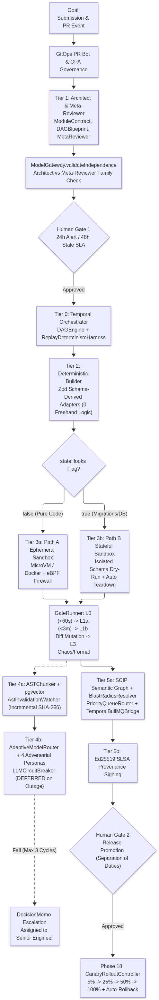
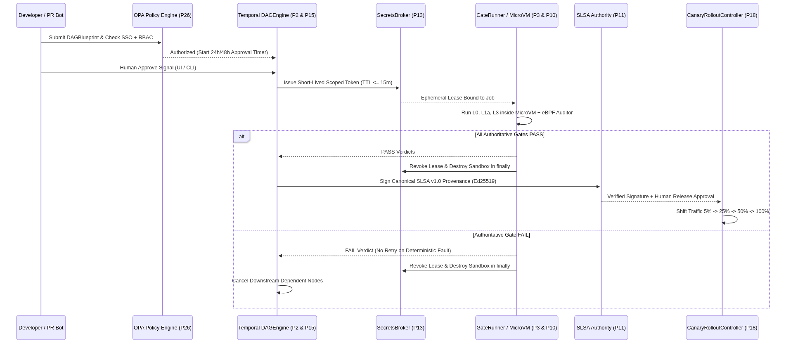
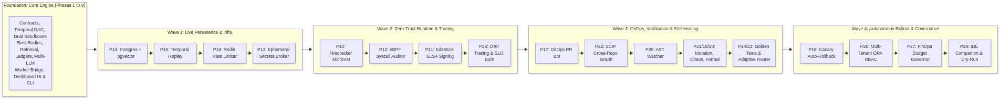
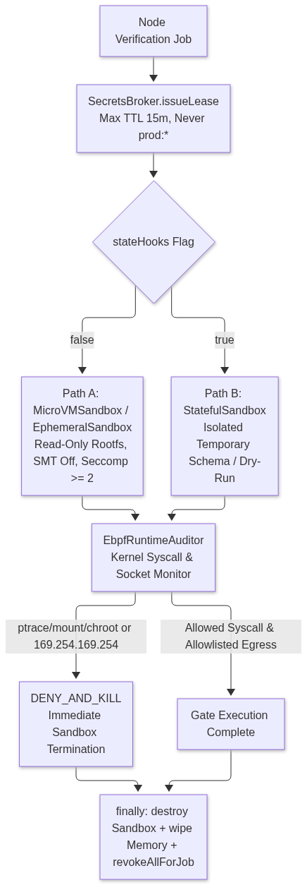
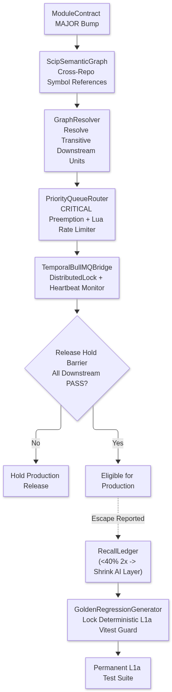

# Fable Engine v3 — Architecture Mermaid Diagrams & Visual Guide

This directory contains the complete visual architecture of **Fable Engine v3** across all **29 Phases (Foundation + Waves 1–4)**, organized into:
* [`diagrams/`](diagrams): Version-controlled `.mmd` Mermaid source definitions.
* [`images/`](images): High-resolution rendered `.png` and vector `.svg` diagram exports.

---

## 1. Six-Tier End-to-End System Architecture

* **Mermaid Source**: [`01-system-architecture-6-tiers.mmd`](diagrams/01-system-architecture-6-tiers.mmd)
* **Rendered Images**: [`PNG`](images/01-system-architecture-6-tiers.png) | [`SVG`](images/01-system-architecture-6-tiers.svg)

### Architectural Explanation
1. **GitOps & Policy Ingress**: PR events verified via HMAC-SHA256 (`@fable/gitops-pr-bot`) and checked against SSO, RBAC, and tenant policies (`@fable/governance-opa`).
2. **Tier 1 (Architect & Meta-Reviewer)**: Generates `DAGBlueprint` and `ModuleContract` definitions validated structurally by `MetaReviewer` and reviewed by an independent LLM family (`ModelGateway.validateIndependence`).
3. **Human Gate 1**: Enforces the 24-hour escalation alert and 48-hour `STALE_PAUSED` SLA before execution starts.
4. **Tier 0 & Tier 2**: Durable `DAGEngine` (`@fable/orchestrator-temporal`, `@fable/temporal-runtime`) dispatches nodes only after upstream `PASS` verdicts, using `DeterministicAdapterBuilder` (zero freehand logic).
5. **Tier 3 & Tier 4**: Routes pure code to **Path A** (Firecracker MicroVM / Ephemeral) and migrations to **Path B** (Stateful schema dry-run), while circuit-broken AI advisory personas propose tests capped at 3 cycles before `DecisionMemo` escalation.
6. **Tier 5 & Canary Rollout**: Resolves cross-repo blast radius (`@fable/scip-graph`), signs SLSA provenance with Ed25519 keys (`@fable/attestation-slsa`), requires separation-of-duties human promotion, and shifts traffic progressively with auto-rollback (`@fable/canary-rollout`).

---

## 2. Runtime Verification, Security & Release Sequence

* **Mermaid Source**: [`02-runtime-verification-sequence.mmd`](diagrams/02-runtime-verification-sequence.mmd)
* **Rendered Images**: [`PNG`](images/02-runtime-verification-sequence.png) | [`SVG`](images/02-runtime-verification-sequence.svg)

### Sequence Explanation
* **Credential Scoping**: Every sandbox execution acquires a short-lived token (`<= 15m` TTL) from `SecretsBroker` that is strictly revoked inside `finally` whether verification succeeds, fails, or times out.
* **No Retries on Deterministic Faults**: Deterministic code/test failures (`L0`/`L1a` `FAIL`) never trigger retries; instead, downstream dependent nodes immediately receive cancellation.
* **Cryptographic Release Lock**: `CanaryRolloutController` refuses to shift traffic unless both explicit human approval and valid Ed25519 SLSA attestations pass verification.

---

## 3. Complete 29-Phase Execution Sequence (Waves 1–4)

* **Mermaid Source**: [`03-phase-roadmap-waves-1-to-4.mmd`](diagrams/03-phase-roadmap-waves-1-to-4.mmd)
* **Rendered Images**: [`PNG`](images/03-phase-roadmap-waves-1-to-4.png) | [`SVG`](images/03-phase-roadmap-waves-1-to-4.svg)

### Roadmap Logic
* **Foundation (`Phases 1–9`)**: Core deterministic state machines, dual sandboxes, blast radius, dual ledgers, multi-family LLM gateway, worker bridge, dashboard UI, and CLI.
* **Wave 1 (`14 ➔ 15 ➔ 16 ➔ 13`)**: Durable PostgreSQL + `pgvector` state, Temporal replay determinism, Redis Lua backpressure throttling, and ephemeral secrets.
* **Wave 2 (`10 ➔ 12 ➔ 11 ➔ 28`)**: Firecracker MicroVM runtime, eBPF kernel syscall/egress auditing, Ed25519 SLSA attestation, and W3C OpenTelemetry tracing.
* **Wave 3 (`17 ➔ 22 ➔ 25 ➔ 21/19/20 ➔ 24/23`)**: GitHub PR Bot, SCIP cross-repo graph, AST invalidation watcher, diff-scoped mutation, chaos/formal gates, golden regression locks, and cost-aware adaptive routing.
* **Wave 4 (`18 ➔ 26 ➔ 27 ➔ 29`)**: Canary auto-rollback, OPA RBAC/Separation-of-Duties, FinOps budget governor, and IDE companion dry-run simulator.

---

## 4. Zero-Trust Sandbox Isolation & eBPF Auditing

* **Mermaid Source**: [`04-zero-trust-sandbox-isolation.mmd`](diagrams/04-zero-trust-sandbox-isolation.mmd)
* **Rendered Images**: [`PNG`](images/04-zero-trust-sandbox-isolation.png) | [`SVG`](images/04-zero-trust-sandbox-isolation.svg)

### Security Boundary Explanation
* **Kernel Hardening**: Firecracker MicroVMs run with read-only rootfs, disabled SMT, and `seccompLevel >= 2`.
* **Runtime Enforcement**: `EbpfRuntimeAuditor` intercepts forbidden syscalls (`ptrace`, `mount`, `chroot`) and blocks cloud IMDS SSRF (`169.254.169.254`) or non-allowlisted outbound sockets with `DENY_AND_KILL`.
* **Deterministic Cleanup**: Memory wiping, container destruction, and credential lease revocation run unconditionally in `finally`.

---

## 5. Blast-Radius Invalidation & Self-Healing Loop

* **Mermaid Source**: [`05-blast-radius-and-self-healing-loop.mmd`](diagrams/05-blast-radius-and-self-healing-loop.mmd)
* **Rendered Images**: [`PNG`](images/05-blast-radius-and-self-healing-loop.png) | [`SVG`](images/05-blast-radius-and-self-healing-loop.svg)

### Self-Healing Explanation
* **Zero False Negatives**: `ScipSemanticGraph` translates compiler symbol references across repositories into transitive `DependencyEdge` paths for `GraphResolver`.
* **Priority Preemption**: `MAJOR` contract bumps preempt background tasks as `CRITICAL` jobs via `PriorityQueueRouter` and `TemporalBullMQBridge` while holding release eligibility until downstream `PASS`.
* **Golden Regression Lock**: Any production escape recorded in `RecallLedger` is compiled into a permanent deterministic `L1a` Vitest guard via `GoldenRegressionGenerator`.
